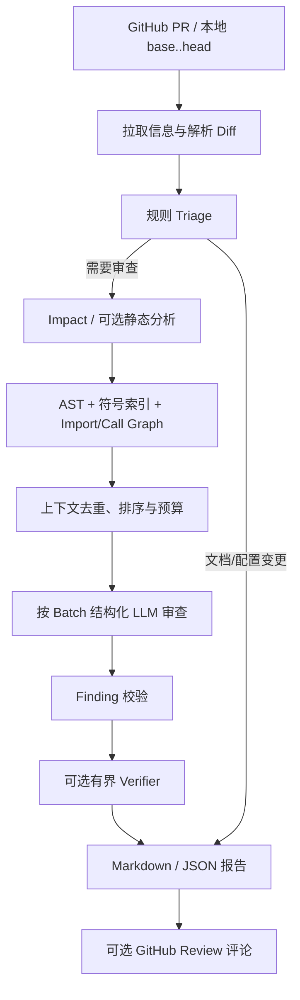

# OpenReview

**面向 GitHub PR 的 AI Code Review：检索代码证据、控制模型预算，并明确呈现不完整结果。**

把整个 diff 直接交给 LLM，常见问题是：缺少跨文件上下文、大 PR 超出上下文窗、finding 行号或证据不可靠、重试和复核推高成本，以及失败被误看作成功。OpenReview 用一条**有界、可验证、可观测**的流水线处理这些工程问题；它不是自主规划的 Agent。

## 全局架构



工作流节点显式编排；模型调用、预算和错误都按单次 run 跟踪。设计权衡、异常路径和局限见[架构说明](docs/ARCHITECTURE.md)。

## 评测状态

AACR-Bench Python/Go 子集：40 个 PR / 10 个仓库，按仓库互斥切分 dev / holdout 各 20 个 PR。当前已完成：

- **full dev production**（20 PR）：P 43.9% / R 17.9% / Balanced 25.4%，20/20 ok
- **3-PR mini ablation**（2 Go + 1 Python）：AST 把 file recall 从 0 提到 89.3%；graph 提高召回但降低精度，balanced 基本持平；verifier 在当前配置下 0 rejection
- **6-PR prompt 实验**（附录）：P 50.0% → 68.0%，R 16.3% → 20.9%，仅作方向验证
- **尚未完成**：full-dev 四档 ablation、holdout production、独立 judge 复核

真实数字、语言分层、失败分析和“不可对外声称”的边界见[评测结果快照](docs/evaluation-results.md)。

## Quickstart

需要 Python 3.11+、Git 和 [uv](https://docs.astral.sh/uv/)。

```bash
uv sync
```

用 mock 响应跑通端到端流程（仍需联网读取公开 PR 并准备仓库）：

```bash
uv run openreview review https://github.com/owner/repo/pull/123 --mock_llm
```

`--dump-intermediates` 的产物结构：

```text
reports/debug/run-001/
  state.json                  # PR、parsed_diff、batches、contexts、stats、trace、outcome
  metrics.json
  prompts/01_single_shot.system.txt
  prompts/01_single_shot.user.txt
  llm/01_single_shot.parsed.json
  validation/01.json          # 每条 finding 的 confidence 变化、丢弃原因、patch 校验
  verifier/01.json            # 每条 finding 的 verdict / reason / confidence
```

该目录只用于本地排查，默认不创建；`--dump-intermediates` 不参与 review cache key，
不会影响缓存命中。

### 本地仓库模式（评测 / 离线回放）

不经过 GitHub API，直接对任意本地 git 仓库的 `base..head` 做 review。适合
AACR-Bench 这类给出 `repo + base_commit + head_commit` 的评测集：

```python
from pathlib import Path
from openreview.services.review_service import ReviewPipeline

with ReviewPipeline(mock_llm=True) as pipeline:
    report = pipeline.run_local(
        repo_path=Path("/path/to/repo"),
        base_sha="<base_commit>",
        head_sha="<head_commit>",
        output_dir=Path("reports/local"),
        owner="encode",
        repo="httpx",
        pr_number=1055,
    )
    result = pipeline.last_result  # ReviewResult，含 source_aspects / metrics
```

`run_local` 会在系统临时目录创建 detached head/base worktree，结束后自动清理
（`keep_worktrees=True` 可保留用于排查）。本地模式不会执行 GitHub 写操作，
`post_comments` 不生效。

`pipeline.last_outcome` 会给出本次运行的结构化状态：`completed` / `skipped` /
`partial` / `failed`。部分 batch 失败或预算耗尽时仍会生成报告，但状态为
`partial`，CLI 以非零退出码返回，评测结果也不会把它当成完整成功。

报告默认写入 `reports/<owner>_<repo>_pr_<number>_review.md`，可用 `--output` 指定目录。

`--post-comment` 只发表 `COMMENT` 类型的 Review，不会替用户 `APPROVE` 或 `REQUEST_CHANGES`，避免在 CI 中越权；需要审批动作时请由人工完成。发布前会按 marker 查找并删除上一轮由 OpenReview 创建的 review，因此同一 PR 重跑是幂等的，不会重复堆积评论。

## 项目结构

```
src/openreview/
├── cli.py                     # Typer CLI
├── github/                    # GitHub REST API 与 PR URL 解析
├── repo/
│   ├── manager.py             # 仓库 clone / fetch / head+base worktree
│   ├── local.py               # 本地 repo + base/head worktree + git diff（评测/离线）
│   └── diff_parser.py         # Hunk、变更行、可见行、符号提取
├── retriever/
│   ├── base.py                # Retriever 协议
│   ├── pathing.py             # AST / index / impact 共用的目录剪枝规则
│   ├── grep.py                # 符号引用检索：rg 优先，git grep 分批 + 有界 Python 兜底
│   ├── tree_sitter_retriever.py  # AST 边界 + 定义/引用 + 测试文件 + base 检索
│   ├── hybrid.py                # AST + 关系索引 + graph 融合与去重
│   ├── index.py                 # SQLite 符号与 import/call 关系索引
│   ├── graph.py                 # import/call graph 扩展（caller/callee/依赖）
│   └── query.py                 # 从 Diff 构造检索查询
├── review/
│   ├── config.py              # ReviewConfig：配置校验 + cache key 指纹
│   ├── prompt_builder.py      # 带行号 Patch、不可信数据包裹、token 预算
│   ├── token_budget.py        # token 估算 / 截断 / 大 PR 分批
│   ├── workflow.py            # 有界工作流、ReviewBudget、ReviewOutcome、trace
│   ├── triage.py              # 规则 triage（docs-only / test-only）
│   ├── impact.py              # 跨文件符号引用分析
│   ├── static_analysis.py     # ruff/mypy 证据源（默认关闭）
│   ├── single_shot.py         # 单遍审查（每个 batch 1 次调用）
│   ├── ablation.py            # 固定四档消融定义
│   ├── finalize.py            # 审查结果收敛（validator / 测试缺口 / injection）
│   ├── output_parser.py       # 结构化 Schema、严重级别校验与聚合
│   ├── finding_validator.py   # 行号 / evidence 校验与结论重算
│   ├── evidence_anchor.py     # 多行 evidence / 省略号 / 缩进锚定修复
│   ├── verifier.py            # critical/high 语义复核
│   ├── cache.py               # review 结果缓存
│   ├── llm_cache.py           # LLM 响应 record/replay
│   ├── assessment.py          # 风险等级 / 决策 / 跨维度去重 / 批次合并
│   ├── test_gap.py            # 基于关联测试文件的测试缺口分析
│   ├── comment_builder.py     # GitHub Review body / 行内评论构造、severity 门禁
│   ├── redaction.py           # 高置信度密钥 / 内网地址脱敏
│   ├── report_writer.py       # Markdown / JSON / Run Metrics 渲染
│   └── llm_client.py          # 真实 / Mock LLM 客户端（含 token usage）
└── services/
    ├── review_service.py      # ReviewPipeline：组件构造 / 生命周期 facade
    └── review_executor.py     # 有界工作流节点实现与 metrics
```

## 设计取舍

关键设计取舍的详细理由见[架构文档 §7](docs/ARCHITECTURE.md#7-关键设计决策索引)。

## 评测

评测分两层：

- **无需 LLM 调用的确定性指标**：行号合法性、按 finding 行号精确匹配源码的 evidence 核验（不可核验项单独统计）、triage、归因、token/调用用量
- **检索缺口指标**：`prompt_context_coverage`、`retrieval_truncated_total`、`cross_batch_duplicates_total` 等，用于区分“召回失败”和“召回后被 cap / prompt 预算丢弃”；它们不是人工标注的 ground-truth recall，但能直接暴露检索链路的损耗位置
- **可选语义指标**：复用 AACR-Bench 官方 LLM judge，计算文件级 Precision / Recall / Balanced

数据使用 AACR-Bench Python/Go 子集的固定切分，同一仓库的 PR 不会跨 split；每种语言分别分配 dev、repo-level holdout 仓库，整体约 5:5。报告提供按语言/仓库分层的语义指标；单 run 不确定性使用仓库簇 bootstrap，多 run 对比使用语言分层的配对 PR bootstrap 95% 置信区间。当前结果统一记录在[评测结果快照](docs/evaluation-results.md)，README 只保留摘要。

确定性指标可以作为 CI 门禁，不消耗 token。评测运行的指标文件默认位于
`evaluation/metrics/`（该目录不提交）；CI 使用仓库内的受控 fixture 验证门禁
CLI 和阈值契约，不代表本次提交运行了模型评测：

```bash
uv run python -m evaluation.cli gate \
  --metrics tests/fixtures/evaluation/ci_deterministic_metrics.json
```

门禁默认要求：结果无 error/missing、未知文件率 0、非法行号率 0、未 grounding 的 evidence 率 0，evidence 可核验率至少 0.8、evidence/归因覆盖率不低于阈值；阈值可用 `--min-*` / `--max-*` 调整。
运行真实或 mock 评测后，可将实际生成的 `deterministic_<run>.json` 传给同一命令检查该次结果。

### 结果与复现

真实结果、语言分层、mini ablation 和失败分析见[评测结果快照](docs/evaluation-results.md)。
复现命令、manifest、分片并发和 semantic judge 配置见[评测手册](evaluation/README.md)。

full dev production（20 PR）：

| 指标 | 值 |
|---|---:|
| N | 20 / 20 ok |
| Findings | 57 |
| Precision | 43.9% |
| Recall | 17.9% |
| Balanced | 25.4% |
| Evidence（锚定后） | 100% |
| Calls / PR | 2.95 |
| Tokens | 912k |
| Latency | 116.8s/PR |

语言分层：

```text
Go:     P 34.4% / R 12.8% / Balanced 18.6%
Python: P 56.0% / R 27.5% / Balanced 36.8%
```

3-PR mini ablation（2 Go + 1 Python，方向性）：

| Tier | Precision | Recall | Balanced | File recall | Tokens |
|---|---:|---:|---:|---:|---:|
| diff | 78.6% | 23.5% | 36.2% | 0.0% | 145.6k |
| ast | 76.9% | 21.6% | 33.7% | 89.3% | 178.8k |
| graph | 63.2% | 25.5% | 36.3% | 89.3% | 185.0k |
| verifier | 64.7% | 21.6% | 32.4% | 89.3% | 236.2k |

解读时至少同时看四件事：**质量（P/R）是否提升、检索覆盖是否提升、token 是否成比例、证据是否仍然可定位**。
3 个 PR 的 P/R 只能看方向，不能做语言或显著性结论；full-dev ablation 和 holdout 仍未运行。

## 测试与工程化

```bash
uv run pytest -q
uv run ruff check src tests evaluation
uv run mypy src evaluation
uv run pre-commit run --all-files
```

CI 配置在 `.github/workflows/ci.yml`：安装依赖后依次执行 ruff、mypy、pytest，最后用跟踪的受控 fixture 运行确定性评测门禁（`evaluation.cli gate`）。这保证 gate 命令和阈值契约有效；它不代表 CI 运行了 AACR 评测或调用了模型。实际结果仍可用同一 gate 命令检查。`ruff` / `mypy` / `pre-commit` 通过 `dependency-groups.dev` 管理。

## 已知限制 / Roadmap

已完成（P0/P1/P2）：
- [x] 行号定位、`suggested_patch` 与 GitHub Review API 行内评论
- [x] 跨维度去重（按文件 + 行号 + reasoning）
- [x] 基于 evidence 的置信度校准
- [x] 大 PR token 预算、按文件分批、Prompt 层截断
- [x] 测试文件关联与测试缺口分析
- [x] base/head 双 worktree，支持查看被删除代码的上下文
- [x] 单遍审查的超时、重试与失败上报
- [x] Prompt Injection 防护与红队测试
- [x] RepoManager：FileLock、blobless clone、平台缓存目录、LRU 式缓存淘汰
- [x] GitHub API 429/5xx/限流重试，CLI `finally` 关闭 HTTP 连接
- [x] 默认结构化检索：tree-sitter AST 主路径 + SQLite 符号/关系索引 + import/call graph；支持 AST / +graph 消融
- [x] 默认采用单遍 Review（每个 batch 1 次调用）；检索与 verifier 收敛为固定四档消融
- [x] 有界工作流（`workflow.py`）：条件节点、`ReviewBudget`、trace
- [x] 规则 triage：docs-only 跳过、test-only 收窄审查重点
- [x] 跨文件影响分析（`impact.py`）
- [x] 可选静态分析证据源（`static_analysis.py`，默认关闭）
- [x] 语义 verifier：critical/high 二次复核（`verifier.py`）
- [x] review 结果缓存与 LLM record/replay（`cache.py` / `llm_cache.py`）
- [x] 真实 token usage 与硬预算（调用数 / token / 耗时）
- [x] `logging`、阶段耗时、token 用量与报告 `Run Metrics`
- [x] 严重级别 `Literal` 化，统一兼容大小写与中文别名
- [x] ruff + mypy + pre-commit + GitHub Actions

后续：
- [x] AACR-Bench 固定切分、确定性指标与官方语义评测适配
- [x] 三点 diff 修复（32/40 个实例的 base 不是分支点）
- [x] evidence 锚定修复（70.2% → 100%，Gate PASS）
- [x] full dev production（20 PR，P 43.9 / R 17.9 / Balanced 25.4）
- [x] 3-PR mini 四档 ablation（方向性结论）
- [x] 6-PR prompt 实验（附录）
- [ ] full-dev 四档 ablation（20 PR × 4 tier）
- [ ] holdout production（冻结后只跑一次）
- [ ] 独立 judge / 人工 audit 校准 precision
- [ ] 增量 review（只重跑变更文件，复用上次结果）
- [ ] 多语言扩展（Java / TypeScript AST）
- [x] 行内评论幂等（按 marker 替换上一轮 review，同一 PR 重跑不重复发评论）
- [x] 确定性评测门禁（`evaluation.cli gate`，不调用模型，可直接放入 CI）

已知限制：
- 只支持 Python / Go；其他语言没有 AST 上下文，效果未做承诺
- call graph 是 best-effort：Python 用 `ast` 抽取，Go 通过 receiver/import/同名方法过滤 caller/callee；不做完整类型解析，也不解析接口动态分发
- patch/context 的 token 数仍是保守估算（ASCII 约 3 字符/token，CJK 按更高权重计），用于预算与截断；真实用量单独记录
- 行内评论只能落在 diff 可见行；不在 diff 行内或 severity 为 medium/low 的问题会写入 Review body，而不是行内评论
- 单文件极大时会先按 hunk / symbol 切片；只有单个 hunk 仍超预算时才截断，可能漏掉该 hunk 后半部分的问题
- 单遍审查的 findings 受单次输出 token 限制；大 PR 会按 batch 拆分，但单个 batch 仍可能截断
- 静态分析默认关闭、CLI 不暴露，且只覆盖 Python；通过 API 开启时会在本地执行 ruff/mypy
- `--mock_llm` 仅验证流程与报告格式，不代表审查质量；仓库中的示例报告也是 mock 演示输出，不应作为真实漏洞发现或评测结果
- full dev production 的 recall 只有 17.9%；50% 的 reference 落在零 finding 文件，生成覆盖仍是主要瓶颈
- semantic judge 与 reviewer 同模型，precision 可能有 self-preference bias；reference comment 稀疏，43.9% 应视为下限
- mini ablation 里 graph 是“召回换精度”，verifier 0 rejection、成本 +28%；二者都还没有证明稳定质量收益
- full-dev ablation 和 holdout 尚未运行；不要把 mini 的方向性结论当成最终结论

- [评测结果快照](docs/evaluation-results.md)：full dev production、mini ablation、prompt 实验、holdout 状态
- [reports 索引](reports/INDEX.md)：当前报告、归档、非结论文件
- [架构地图](docs/ARCHITECTURE.md)：系统边界、生命周期、关键决策索引
- [架构决策 ADR](docs/decisions/)：有界工作流、结构化检索、预算下沉、单遍审查、partial outcome、检索执行、triage、validator/verifier、预算可观测、安全发布
- [节点与预算契约](docs/architecture/03-workflow.md)：13 个节点的输入/输出/失败语义
- [评测方法](docs/architecture/08-evaluation.md)：指标定义、数据切分、四档消融、当前状态
- [评测复现步骤](evaluation/README.md)
