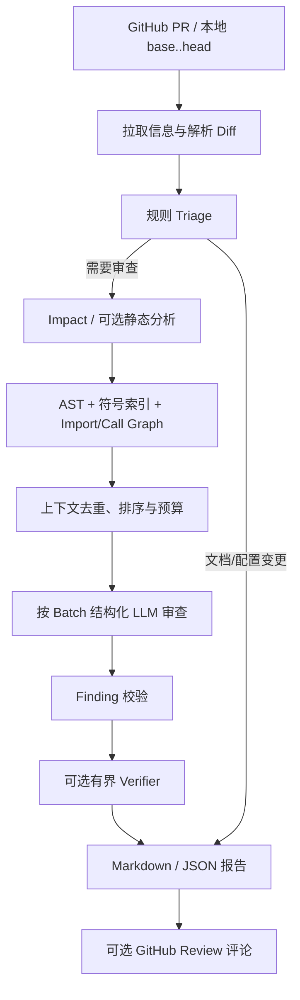

# OpenReview

**面向 GitHub PR 的 AI Code Review：检索代码证据、控制模型预算，并明确呈现不完整结果。**

把整个 diff 直接交给 LLM，常见问题是：缺少跨文件上下文、大 PR 超出上下文窗、finding 行号或证据不可靠、重试和复核推高成本，以及失败被误看作成功。OpenReview 用一条**有界、可验证、可观测**的流水线处理这些工程问题；它不是自主规划的 Agent。

## 全局架构



工作流节点显式编排；模型调用、预算和错误都按单次 run 跟踪。设计权衡、异常路径和局限见[架构说明](docs/ARCHITECTURE.md)。

## 消融结果

评测工具支持从纯 Diff 到 AST、代码图谱和 Verifier 的固定对照。**质量和成本评测尚未完成，空白单元格不是零值或结论。**评测集配置：AACR-Bench Python/Go 子集，共 43 个 PR、10 个仓库，按仓库隔离为 dev/test/holdout（7/26/10 个 PR）。

| 配置 | 相对上一档 | 语义质量 | 检索覆盖 | 调用 / Token | 延迟 |
|---|---|---:|---:|---:|---:|
| `diff` | 仅 Patch |  |  |  |  |
| `ast` | + AST 上下文 |  |  |  |  |
| `graph` | + 代码图谱 |  |  |  |  |
| `verifier` | + Finding 复核 |  |  |  |  |

## Quickstart

需要 Python 3.11+、Git 和 [uv](https://docs.astral.sh/uv/)。

```bash
uv sync
```

用 mock 响应跑通端到端流程（仍需联网读取公开 PR 并准备仓库）：

```bash
uv run openreview review https://github.com/owner/repo/pull/123 --mock_llm
```

真实模型调用需设置 `OPENAI_API_KEY`；私有仓库或需要更高 GitHub API 限额时可选设置 `GITHUB_TOKEN`：

```bash
export OPENAI_API_KEY=...
# export GITHUB_TOKEN=...

uv run openreview review https://github.com/owner/repo/pull/123 \
  --model gpt-4o \
  --budget-calls 8 \
  --budget-tokens 20000 \
  --budget-output-tokens 8000 \
  --budget-seconds 120 \
  --max-completion-tokens 2048 \
  --json-out reports/result.json
```

输入 Token 使用字符估算，估算误差可能使已发出的单次请求超过上限；时间预算约束 LLM 请求，不等同于整个流程的墙钟超时。Mock 仅验证链路，不代表审查效果。

**工程状态：**当前 335 项测试通过，ruff 与全包 mypy 检查通过。评测框架和固定样本已准备，实际质量结果待补。

---

详细设计与局限见 [`docs/ARCHITECTURE.md`](docs/ARCHITECTURE.md)；评测复现步骤见 [`evaluation/README.md`](evaluation/README.md)。
