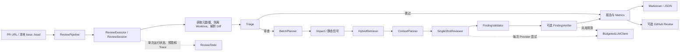

# OpenReview 架构说明

OpenReview 面向 GitHub Pull Request 与本地 commit 区间，目标是让 AI 审查具备可追溯证据、显式成本边界和可信失败状态。它不是自主编程 Agent：流程由代码固定编排，模型不能自行增加工具或无限循环。

## 全局架构

`ReviewPipeline` 是组合根，负责构造 GitHub/仓库适配器、检索器、LLM、缓存、审查器和执行器。每个 `ReviewSession` 创建独立 executor、预算客户端及审查组件；`ReviewState` 汇总 diff、batch、上下文、错误、阶段耗时、LLM usage 和最终 outcome。`ReviewExecutor` 运行固定的 13 个节点，按本地模式、缓存命中、triage 等状态跳过不需要的步骤。

一次典型审查经历：获取 PR 文件或准备本地 base/head worktree；解析 diff 并用规则 triage；规划 batch、收集额外证据并检索代码；在预算内构造 prompt；执行结构化模型调用、校验 finding、可选二次验证；最后写报告和 metrics，必要时发布 GitHub 评论。

## 核心设计决策与权衡

### 固定工作流，不做自由 Agent

代码审查的阶段相对稳定，显式节点比模型自主规划更易测试、限额和复现。动态分支仅用于 triage、verifier 有界重试和检索降级。代价是扩展能力需改代码，但每条路径都能说明何时执行、消耗多少预算以及失败后如何处理。

### 结构化检索，按价值分配上下文

默认 `HybridRetriever` 增量维护索引，并并行执行 tree-sitter AST 与图谱检索，寻找变更所在函数/类、相关定义与依赖、引用/调用方、字段、关联测试，以及可用的 base 版本代码。索引或图谱故障时尽量保留 AST 结果，并按条件走 grep fallback。

上下文先去重，再按六级优先级装配：静态证据、变更所在代码、定义、引用、字段、测试。Priority/kind 上限、按文件轮询和独立上下文预算，减少大文件挤占其他变更证据的风险；同文件上下文紧邻 diff 展示。这里选择精确、可解释的结构关系，而非广泛语义搜索。代价是解析器不覆盖所有语言，索引无法代表的关系也可能漏检。

### 每个 Batch 一次调用，重要 Finding 再核验

默认 single-pass 在一次结构化输出中覆盖多个风险类别，避免每个类别独立调用造成约四倍调用量和额外聚合成本；相应地，类别注意力竞争，不能假设其效果与多轮审查相同。规则 triage 只调整重点，安全等类别仍可被模型报告。可选 verifier 对指定严重度或置信度的 finding 做有限复核，增加成本与延迟，但与主审查共用预算。

Pydantic 结构化输出只保证响应形状。`FindingValidator` 进一步校验文件、diff 行号、证据定位、置信度、重复项及可选补丁是否能应用。严格校验可能丢弃合理但证据不足的发现；通过校验也不等于语义正确。

### 预算是多种边界，而非精确账单

每个 run 的 `ReviewBudget` 线程安全，主审查、verifier 和显式重试共用。每次 Provider 尝试会先预留调用和输出 Token；输出额度同时用于请求的 `max_completion_tokens`。SDK 隐式重试关闭，每次重试独立计账。LLM 请求超时不超过配置 timeout 与剩余时间预算。

输入 Token 采用考虑中日韩字符的启发式估算，包含 system/user prompt 与响应 schema。Provider 返回 usage 后再校正，因此估算误差可能令当前请求超过输入上限，但后续调用会受阻；这不是精确账单硬上限。输出上限还依赖兼容服务遵守请求参数。时间限制针对模型请求，不覆盖本地检索、仓库准备和所有后处理。项目暂不计算金额，因为 Provider 单价、缓存计费和折扣尚未配置。

### 部分结果、失败和并发均显式归属

单个 batch 失败会记录错误并继续；只要已有有效结果，最终 outcome 标为 `partial`。流程整体失败时也尽力保存 run metrics 和 debug 状态，再重新抛出原错误。指标写盘本身仍是 best-effort，磁盘故障时无法保证持久化。

每个 session 有独立预算客户端，底层 Provider 客户端可共享连接配置。每次请求都携带 `run_id`、attempt、请求超时与输出上限；metrics 按 `run_id` 汇总调用日志，而非对共享累计计数器做前后差分，避免并发 run 互相污染。检索索引与缓存仍需各自遵循并发锁和数据隔离规则。

## 已量化成果

| 工程项 | 当前可核实数据 | 说明 |
|---|---:|---|
| 单元/集成测试 | 335 项通过 | 验证当前工程契约，不代表模型审查质量 |
| 固定评测样本 | 43 个 PR / 10 个仓库 | AACR-Bench Python/Go 子集 |
| 仓库互斥切分 | 7 dev / 26 test / 10 holdout | 每个仓库仅属一个 split |
| 评测指标 | 确定性、检索、可选语义 | 支持多配置报告；实际消融结果尚未填写 |

质量表刻意留白，待在同一模型、同一切分上完成并复核后填写：

| 配置 | 语义质量 | 检索覆盖 | 调用 / Token | 延迟 |
|---|---:|---:|---:|---:|
| `diff` |  |  |  |  |
| `ast` |  |  |  |  |
| `graph` |  |  |  |  |
| `verifier` |  |  |  |  |

消融顺序分别为纯 Diff、增加 AST、增加代码图谱、增加后置 Verifier。需要同时报告质量、检索覆盖、调用量、Token、延迟和不确定性；Mock 只验证执行流程，不能替代效果数据。

## 已知局限与演进方向

- AST/索引主要覆盖 Python 和 Go；其他语言以 diff 为主。Call graph 是候选证据，不是完整类型或数据流分析。
- Token 估算与具体模型 tokenizer 有偏差；部分兼容 Provider 或网络失败无法返回真实 usage。
- 当前报告调用量和 Token，不提供价格、集中式指标后端或告警系统。
- Prompt injection 缓解和凭证脱敏是风险降低措施，不是安全保证。静态分析会执行本地工具，处理不可信仓库应使用隔离环境。
- 评测样本规模有限，尚无已发布的质量/成本对照结论，不能仅凭一个总分断言泛化能力。

后续优先完成固定消融评测并发布分层结果与不确定性；再按实测误差校准 Token 估算，并根据漏检案例扩展语言/符号关系。只有在部署场景需要时，再建设集中式指标导出、调试数据留存策略和更强的仓库执行隔离。
