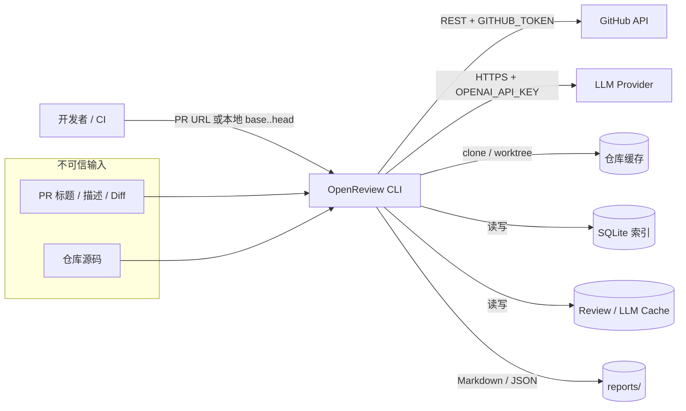
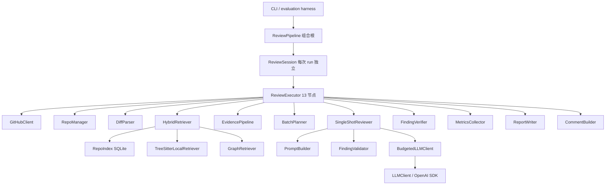
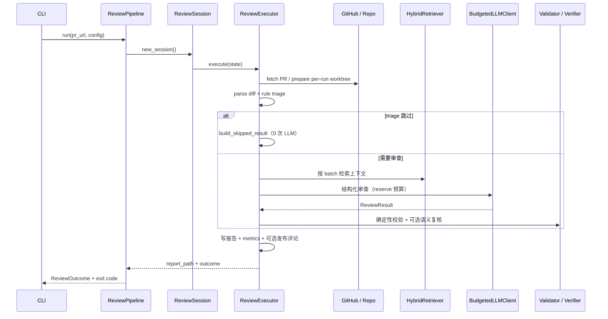

# OpenReview 架构

> 面向 GitHub PR 与本地 commit 区间的 AI Code Review 流水线：**有界、可验证、可观测**。
> 本文是系统地图；节点/预算/检索/指标的准确契约见 [`architecture/`](architecture/)，关键取舍见 [`decisions/`](decisions/)。

## 1. 文档定位

| 项 | 内容 |
|---|---|
| 读者 | 新贡献者、架构评审、未来的自己 |
| 覆盖 | 系统边界、容器、生命周期、关键决策、失败模型 |
| 不覆盖 | API reference、逐行实现细节、评测操作步骤 |
| 适用版本 | prompt `review-v8` / validator `v2` / retriever `hybrid-v5` / index schema `6` / metrics `5` |

## 2. TL;DR

OpenReview 是一条**有界、可验证、可观测**的 PR 审查流水线。

- **不是 Agent**：13 个固定节点，模型不能增加工具、不能自循环；条件边全部由代码定义。
- **不是 RAG**：检索以符号、import、call 的精确结构为主，向量检索不启用。
- **不是计费系统**：预算是调用数/输入 token/输出 token/时间的硬护栏；输入 token 是保守估算，不是精确账单。
- **失败可见**：`completed / skipped / partial / failed` 四态，CLI 退出码 `0 / 1 / 2`。
- **当前状态**：工程契约 455 tests 通过；full dev production 与 3-PR mini ablation 已完成，full-dev ablation 与 holdout 待跑。真实结果见 [`evaluation-results.md`](evaluation-results.md)。

## 3. 系统上下文（C4 L1）

**信任边界**：PR 文本与仓库源码都是不可信数据；LLM 输出同样是不可信输入，必须经过 Validator/Verifier。详见 [`architecture/06-trust.md`](architecture/06-trust.md)。

## 4. 容器视图（C4 L2）

关键边界：

- `ReviewPipeline` 只做装配与生命周期；每个 `ReviewSession` 持有独立 budget、executor、reviewer、verifier、run_id。
- `ReviewExecutor` 只负责把 `ReviewState` 跑过固定节点，不构造客户端。
- 领域规则（风险、去重、合并）在 `domain/policies.py`，是纯函数，报告/校验/评测共用。

## 5. 一次 Review 的生命周期

数据形态：`PRInfo → ChangedFile[] → ParsedDiff → Batch[] → CodeContext[] → Prompt → ReviewResult → Validated/Verified → Markdown/JSON → GitHub Review`。每一跳的契约见 [`architecture/02-lifecycle.md`](architecture/02-lifecycle.md)。

## 6. 13 个节点（总览）

| # | 节点 | 作用 | 可跳过 | 失败语义 |
|---:|---|---|---|---|
| 1 | `parse_url` | 解析 PR URL | 本地模式 | 终止 → `failed` |
| 2 | `fetch_pr` | 拉取 PR 元数据与文件 | 本地模式 | 终止 → `failed` |
| 3 | `load_local` | 构造本地 review 输入 | 非本地 | 终止 → `failed` |
| 4 | `cache_lookup` | 命中完整结果则短路 | cache 关闭 | 未命中继续 |
| 5 | `prepare_repo` | per-run worktree + base worktree | cache 命中 / 本地 | PR worktree 失败终止；base 失败仅降级 |
| 6 | `prepare_local` | 本地 base/head worktree | 非本地 / cache 命中 | 终止 → `failed` |
| 7 | `parse_diff` | 解析 diff、提取符号 | cache 命中 | 终止 → `failed` |
| 8 | `triage` | 规则决定跳过或收窄重点 | cache 命中 | 抛异常 → `failed` |
| 9 | `analyze` | 分批检索 + LLM 审查 | cache 命中 / triage 跳过 | 单 batch 失败 → `partial`；全部失败 → `failed` |
| 10 | `verify` | 对高优 finding 二次复核 | verifier 关闭 / 无结果 | 内部容错，保留原 finding |
| 11 | `write_report` | 写 Markdown | 无 | 终止 → `failed` |
| 12 | `post_comments` | 发布/替换 GitHub Review | 未开启 / cache / 本地 | 失败 → `failed`（报告已落盘） |
| 13 | `finalize` | 解析 outcome、补 metrics、写缓存 | 无 | 终止 → `failed` |

完整输入/输出/跳过条件/降级路径见 [`architecture/03-workflow.md`](architecture/03-workflow.md)。

## 7. 关键设计决策（索引）

| ADR | 决策 | 一句话理由 |
|---|---|---|
| [ADR-0001](decisions/ADR-0001-bounded-workflow.md) | 固定 13 节点工作流，不做自由 Agent | 审查阶段稳定；可测试、可限额、可复现 |
| [ADR-0002](decisions/ADR-0002-structural-retrieval.md) | 精确符号图优先，不启用向量检索 | Code Review 需要可解释的符号/行定位 |
| [ADR-0003](decisions/ADR-0003-budget-in-client.md) | 预算下沉到 LLM 客户端 | 重试/verifier/并发 aspect 都绕不开同一本账 |
| [ADR-0004](decisions/ADR-0004-single-pass-per-batch.md) | 每个 batch 一次结构化调用 | 避免四倍调用量，先证明收益再增加维度 |
| [ADR-0005](decisions/ADR-0005-partial-outcome.md) | `partial` 是一等状态 | 失败不能伪装成完整成功 |
| [ADR-0006](decisions/ADR-0006-retrieval-execution.md) | AST/Graph 优先，rg 兜底 | 结构化证据 + 可降级执行 |
| [ADR-0007](decisions/ADR-0007-rule-based-triage.md) | 规则 triage，不用模型 | 避免“调用 LLM 决定是否调用 LLM” |
| [ADR-0008](decisions/ADR-0008-validator-verifier.md) | Validator 确定性校验 + Verifier 有界复核 | 行号/证据可机器核验，语义复核受预算约束 |
| [ADR-0009](decisions/ADR-0009-prompt-budget-observability.md) | Prompt/context 预算与可观测性 | 大 PR 不爆窗，损耗位置可定位 |
| [ADR-0010](decisions/ADR-0010-safety-publication.md) | 安全边界与发布策略 | 不可信输入隔离、静态分析 opt-in、只发 COMMENT |

详细取舍已拆分为上述 ADR；本节只保留索引。新增关键机制时按
[`decisions/README.md`](decisions/README.md) 的规则补 ADR。

## 8. 失败与降级总览

| 失败点 | 降级动作 | outcome | 用户可见 |
|---|---|---|---|
| GitHub API 失败 | 重试后终止 | `failed` | exit 1 + 错误 |
| 索引构建失败 | grep fallback | `completed` / `partial` | `retrieval.stats.index_error` |
| Graph 检索失败 | 仅保留 AST，必要时补 grep | `completed` | `retrieval.graph_error` |
| 单 batch LLM 失败 | 继续其他 batch | `partial` | `failed_batches` |
| 预算耗尽 | 停止后续调用 | `partial` | `budget_exhausted` |
| base worktree 失败 | 删除代码上下文不完整 | `completed` | `review_notes` + `base_error` |
| Validator 丢弃 | 过滤后重算风险 | `completed` | `validation` 统计 |
| Verifier 失败/超时 | 保留原 finding | `completed` | `verifier` 统计 + note |

完整矩阵见 [`architecture/03-workflow.md`](architecture/03-workflow.md) §4。

## 9. 质量属性与当前状态

| 属性 | 机制 | 当前状态 |
|---|---|---|
| 可测试性 | 端口/适配器、纯领域策略、LLM record/replay | 455 tests 通过（~30s） |
| 成本可控 | 客户端级预算账本、输出预留、时间上限 | 硬护栏；输入 token 为估算 |
| 可追溯 | `run_id`、trace、metrics schema、debug sink | 单 run JSON 可还原 |
| 可降级 | partial outcome、检索 fallback、单 batch 隔离 | 已实现 |
| 可评测 | 四档消融、确定性指标、CI gate | full dev production + 3-PR mini ablation 已完成；full-dev ablation / holdout 待跑 |
| 安全 | 不可信输入隔离、脱敏、未知 verdict 收敛 | 风险降低，非安全保证 |

## 10. 已知局限与路线图

- AST/索引主要覆盖 Python 与 Go；其他语言以 diff 为主。
- Call graph 是候选证据，不是完整类型或数据流分析。
- 输入 token 为启发式估算，部分 Provider 不返回真实 usage。
- 时间预算只约束 LLM 请求，不覆盖仓库准备与全部后处理。
- 不计算金额；无集中式指标后端与告警。
- 静态分析会执行本地工具，处理不可信仓库应使用隔离环境。
- 评测样本 40 个 PR / 10 个仓库；dev 20 / holdout 20。当前只有 full dev production 与 3-PR mini ablation，full-dev ablation 和 holdout 尚未运行。
- 当前 semantic judge 与 reviewer 同模型，precision 可能有 self-preference bias；reference comment 稀疏，precision 应视为下限。
- mini ablation 显示 graph 是“召回换精度”，verifier 在当前配置下未拒绝候选；两者都还不能对外声称质量收益。

路线图：完成固定消融并发布分层结果与不确定性 → 按实测误差校准 token 估算 → 按漏检案例扩展语言/符号关系 → 按部署需要补服务化、集中指标与执行隔离。

## 11. 术语与版本

术语见 [`reference/glossary.md`](reference/glossary.md)，配置默认值见 [`reference/config.md`](reference/config.md)，版本矩阵见 [`README.md`](README.md)。
