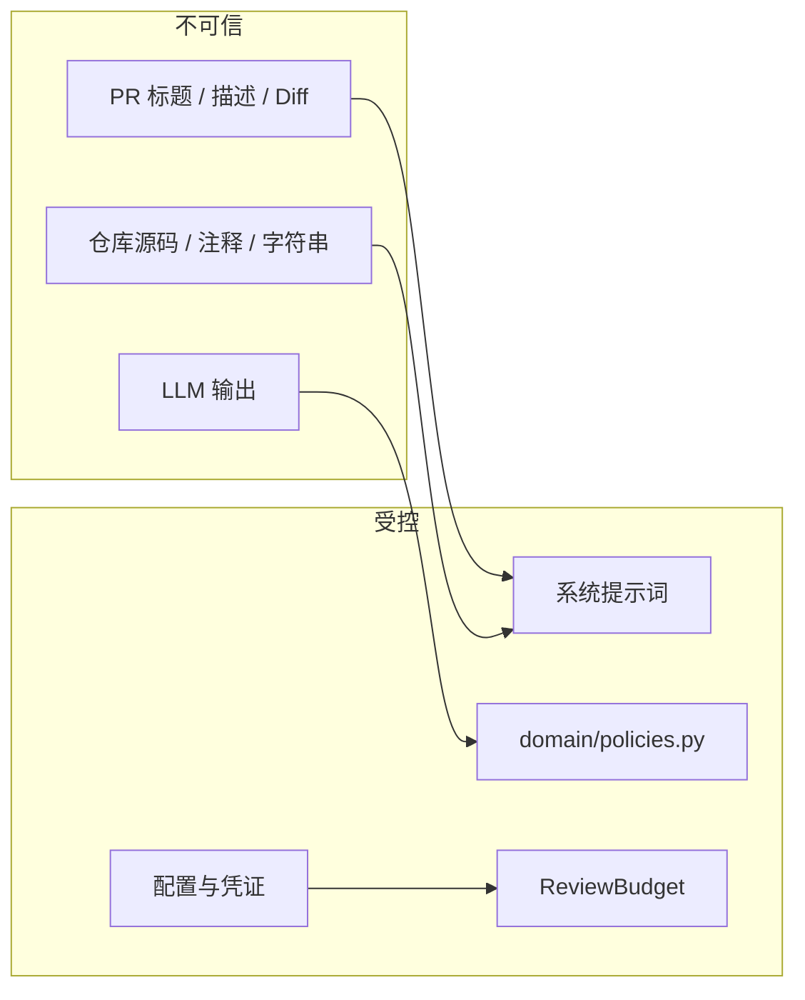

# 01 · 上下文与容器

## 1. 外部系统

| 外部系统 | 用途 | 凭证 | 失败影响 |
|---|---|---|---|
| GitHub REST API | 读 PR 元数据/文件、发布 Review | `GITHUB_TOKEN`（可选） | 拉取失败终止；发布失败在报告落盘后终止 |
| LLM Provider（OpenAI 兼容） | 结构化审查与 Verifier | `OPENAI_API_KEY` | 单 batch 失败降级为 `partial`；全部失败终止 |
| Git | clone、worktree、diff、`git apply --check` | 本地 git | 仓库准备失败终止 |
| 本地文件系统 | 仓库缓存、SQLite 索引、review/LLM cache、报告 | 无 | 报告/缓存写盘失败按 best-effort 处理 |
| 静态分析工具（可选） | `ruff` 等，仅 changed lines | 无 | 工具缺失/失败写入 notes，不阻断 |

## 2. 容器职责

| 容器 | 代码入口 | 职责 | 生命周期 |
|---|---|---|---|
| CLI | `src/openreview/cli.py` | 参数解析、装配 Pipeline、打印 outcome | 进程 |
| ReviewPipeline | `services/review_service.py::ReviewPipeline` | 组合根：构造客户端、retriever、reviewer、cache | 可复用 |
| ReviewSession | `services/review_session.py::ReviewSession` | 单次 run 的 budget、executor、run_id | 每次 run |
| ReviewExecutor | `services/review_executor.py::ReviewExecutor` | 执行 13 节点、释放 worktree | 每次 run |
| ReviewState | `review/workflow.py::ReviewState` | 单次 run 的全部中间态与统计 | 每次 run |
| GitHubClient | `github/client.py` | REST、重试、Review upsert | 可复用 |
| RepoManager | `repo/manager.py` | clone、per-run worktree、FileLock、缓存清理 | 可复用 |
| DiffParser | `repo/diff_parser.py` | patch → 文件/行/hunk/符号 | 无状态 |
| HybridRetriever | `retriever/hybrid.py` | 索引刷新 + AST/Graph 并行 + 预算装配 | 可复用（带锁） |
| RepoIndex | `retriever/index.py` | SQLite 符号/import/call 索引 | 每仓库 |
| SingleShotReviewer | `review/single_shot.py` | 每 batch 一次结构化调用 | 每 session |
| FindingValidator | `review/finding_validator.py` | 确定性校验与风险重算 | 每 session |
| FindingVerifier | `review/verifier.py` | 高优 finding 的反证式复核 | 每 session |
| BudgetedLLMClient | `review/llm_client.py` | 预算预留/结算、超时、重试计账 | 每 session |
| MetricsCollector | `services/metrics_collector.py` | 组装 RunMetrics | 每 session |
| ReportWriter | `review/report_writer.py` | Markdown/JSON 渲染 | 无状态 |

## 3. 信任边界



| 边界 | 风险 | 缓解 | 残留风险 |
|---|---|---|---|
| PR/仓库 → prompt | Prompt injection、伪造指令 | `<untrusted_input>` 包裹 + 系统约束 | 模型仍可能被绕过 |
| 仓库源码 → 本地工具 | 执行不可信代码/命令 | 默认关闭静态分析；文档要求隔离环境 | 无沙箱 |
| 模型输出 → 报告/评论 | 幻觉行号、错误证据、密钥回显 | Validator + Verifier + redaction | 语义正确性不保证 |
| 凭证 → 日志/评论 | Token 泄漏 | 环境变量、日志不打印、redaction | best-effort |
| 多 run 并发 | 预算/缓存/索引互相污染 | per-run session、FileLock、run_id | 索引与缓存需遵守锁规则 |

## 4. 部署与运行形态

当前是 **CLI 进程**，不是常驻服务：

```
openreview review <pr_url> [options]
  ├─ 读配置/环境变量
  ├─ clone 或复用仓库缓存
  ├─ 创建 per-run worktree（PR 模式）
  ├─ 读/写 SQLite 索引（FileLock）
  ├─ 读/写 review cache 与 LLM cache（FileLock）
  └─ 写 reports/*.md 与可选 *.json
```

| 目录 | 默认位置 | 内容 |
|---|---|---|
| 仓库缓存 | 平台缓存目录 / `OPENREVIEW_CACHE_DIR` | 共享 clone |
| 索引 | 缓存目录同级 `index/` / `OPENREVIEW_INDEX_DIR` | 每仓库 SQLite |
| Review cache | `--cache-dir` / `OPENREVIEW_REVIEW_CACHE_DIR` | 完整 ReviewResult |
| LLM cache | `--llm-cache-dir` | record/replay 响应 |
| 报告 | `--output` | Markdown |
| JSON | `--json-out` | 机器可读结果 |
| Debug | `--dump-intermediates` | state/metrics |

## 5. 并发模型

| 资源 | 作用域 | 同步机制 | 说明 |
|---|---|---|---|
| `ReviewBudget` | 每 run | `threading.RLock` | `reserve` 原子检查+扣减 |
| `ReviewSession` | 每 run | 无共享 | budget、reviewer、verifier 独立 |
| PR/base worktree | 每 run | lease + `FileLock` | run 结束释放 |
| 共享 clone | 每仓库 | `FileLock` per repo | clone/fetch 串行 |
| SQLite 索引 | 每仓库 | `FileLock` per index | 增量构建串行 |
| Review cache | 跨 run | 文件锁 + 原子写 | 只缓存完整结果 |
| LLM cache | 跨 run | per-key lock | record/replay |
| Metrics | 每 run | `run_id` 归属 | 不做共享计数器差分 |

> 并发 run 的安全性依赖“每 run 独立预算 + 每仓库锁 + 只缓存完整结果”三条规则；新增共享资源时必须补锁与隔离说明。

## 6. 两种输入模式

| 模式 | 触发 | 数据来源 | 跳过的节点 |
|---|---|---|---|
| PR 模式 | `review <pr_url>` | GitHub REST + per-run worktree | `load_local`、`prepare_local` |
| 本地模式 | `review --local-repo ... --base ... --head ...` | 本地 git worktree | `parse_url`、`fetch_pr`、`prepare_repo`、`post_comments` |

两种模式共用 `parse_diff → triage → analyze → verify → report`，保证评测与线上路径一致。
