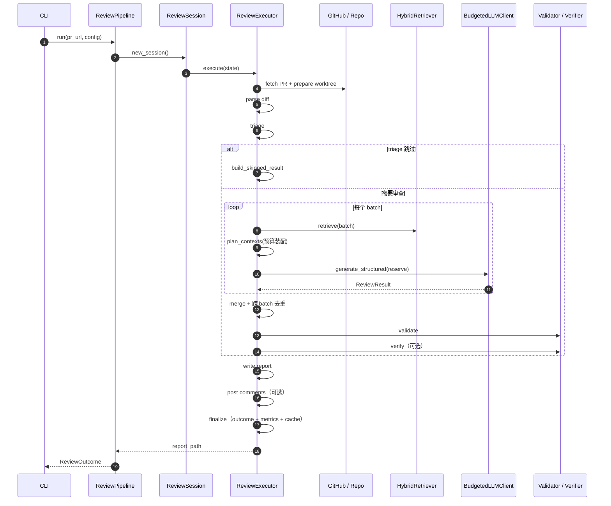
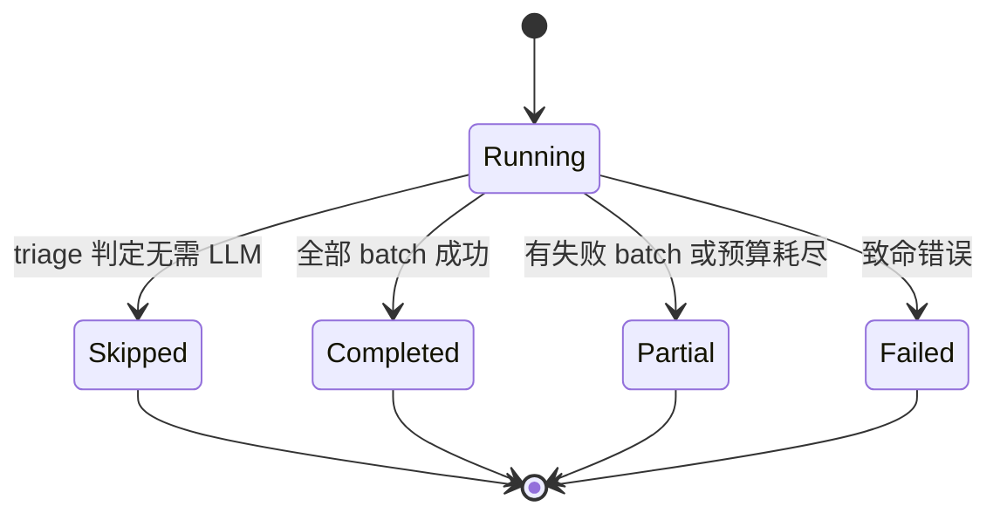

# 02 · 生命周期与状态

## 1. 时序



## 2. Artifact 契约

| Artifact | 产生者 | 消费者 | 关键字段 |
|---|---|---|---|
| `PullRequestInfo` | `fetch_pr` / `load_local` | prompt、report、comment | owner/repo/base_sha/head_sha |
| `ChangedFile[]` | `fetch_pr` / `prepare_local` | `DiffParser` | filename/status/patch |
| `ParsedDiff` | `parse_diff` | triage、batch、retriever | files、hunks、changed_lines、symbols |
| `Batch`（`ParsedDiff`） | `BatchPlanner` | retriever、reviewer | 文件子集、token 成本 |
| `CodeContext` | `HybridRetriever` / `EvidencePipeline` | `PromptBuilder` | file、lines、kind、priority、revision |
| `Prompt` | `PromptBuilder` | `BudgetedLLMClient` | system/user、untrusted 包裹 |
| `ReviewResult` | `SingleShotReviewer` | Validator/Verifier/Report | issues、risk、decision、metrics |
| `Validated ReviewResult` | `FindingValidator` | Verifier/Report | 过滤后的 issues、重算风险 |
| `VerifierStats` | `FindingVerifier` | metrics | candidates/rejected/needs_context |
| `RunMetrics` | `MetricsCollector` | JSON、评测 | retrieval/budget/outcome/errors |
| `ReviewOutcome` | `OutcomeResolver` | CLI、缓存 | status/failed_batches/degraded_reasons |

## 3. Outcome 状态机



| 状态 | 条件 | `ok` | exit code | 是否写 review cache |
|---|---|---:|---:|---|
| `completed` | 无失败 batch、无预算耗尽 | ✅ | 0 | ✅ |
| `skipped` | triage 判定文档/配置/空变更 | ✅ | 0 | ✅ |
| `partial` | `failed_batches > 0` 或 `budget_exhausted` | ❌ | 2 | ❌ |
| `failed` | 工作流抛异常 / 无报告 | ❌ | 1 | ❌ |

> 只缓存 `ok` 的结果，避免下一次 run 把“部分失败”伪装成完整成功。

## 4. 缓存语义

### 4.1 Review cache key

```
fingerprint(
  pr_url,
  base_sha,
  head_sha,
  model,
  temperature,
  seed,
  prompt_version,
  validator_version,
  retriever_version,
  review_cache_schema,
  config.cache_key_parts(),   # ablation/retrieval/triage/impact/static/verifier/batch/context/timeout/...
)
```

命中条件：同一 PR、同一 head、同一模型采样参数、同一 artifact 版本、同一输出相关配置。

### 4.2 LLM cache

| 模式 | 行为 |
|---|---|
| `auto` | 有缓存则 replay，否则请求并 record |
| `record` | 强制请求并写入 |
| `replay` | 只读；miss 抛 `LLMCacheMiss` |

用途：改 Validator/Verifier/聚合策略时离线回放，不重复消耗 token。

## 5. 报告与 metrics 的写盘顺序

1. `write_report` 先写 Markdown（此时 metrics 尚未补齐）。
2. `finalize` 组装完整 `RunMetrics`，再次覆盖 Markdown。
3. `finalize` 在 `outcome.ok` 时写 review cache。
4. `execute` 的 `finally` 释放 worktree。
5. 若工作流抛异常：尽力写 metrics JSON、debug state，再重新抛出原错误。

> 报告写盘失败、metrics 写盘失败、worktree 释放失败都不会掩盖原始错误；它们分别记录日志。

## 6. 本地模式与 PR 模式的差异

| 项 | PR 模式 | 本地模式 |
|---|---|---|
| PR 元数据 | GitHub API | 由 base/head SHA 构造 |
| 仓库 | 共享 clone + per-run worktree | 本地 repo + 临时 base/head worktree |
| 评论发布 | 可选 | 禁用 |
| 缓存 key | PR URL + SHA | 本地标识 + SHA |
| 清理 | 释放 worktree lease | 按 `keep_worktrees` 清理 |

两条路径在 `parse_diff` 之后完全共用，确保评测结果可迁移到线上。
