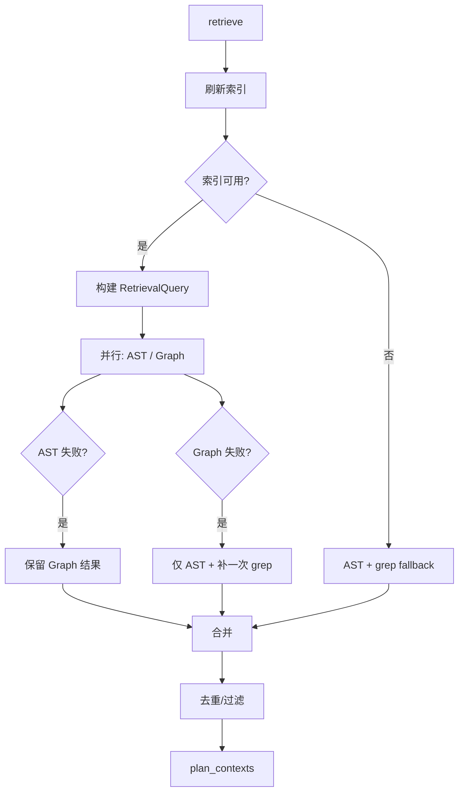

# 04 · 检索与上下文装配

## 1. 目标与非目标

| 目标 | 非目标 |
|---|---|
| 精确定位变更所在的函数/类 | 全仓库语义相似搜索 |
| 找到定义、引用、调用方、字段、关联测试 | 完整类型推导/数据流分析 |
| 增量、可解释、可降级 | 覆盖所有语言 |
| 在固定 token 预算内最大化证据价值 | 无限注入上下文 |

## 2. SQLite 索引

`RepoIndex`（`src/openreview/retriever/index.py`）默认落在平台缓存目录，不写仓库。

### 2.1 Schema

| 表 | 关键字段 | 用途 |
|---|---|---|
| `files` | `path`、`blob_sha`、`size` | 增量判断 |
| `symbols` | `name`、`qualname`、`kind`、`file`、`start_line`、`end_line` | 定义查找 |
| `imports` | `file`、`module`、`names` | 依赖/import 关系 |
| `calls` | `caller_file`、`caller`、`callee` | 调用候选 |

- 支持后缀：`.py`、`.go`
- 单文件上限：500 KB
- 文件数上限：20,000
- schema 版本：`INDEX_SCHEMA_VERSION = "3"`

### 2.2 增量算法

```text
FileLock(index.lock)
  head = git rev-parse HEAD
  if schema_version != current: force = True
  if not force and old_head == head: 直接复用
  if old_head 可用: changes = git diff --name-status old_head..head
  else: 全量扫描并删除 stale 文件
  for change:
    D → 删除
    R → 删除旧路径 + 索引新路径
    M/A → 按 blob SHA 判断是否需要重排
  set head_sha / schema_version / indexed_at
```

- `git_blob_sha` 与 git 一致（`blob <len>\0<data>` 的 SHA-1），避免 mtime 误判。
- 同一仓库的多次 review 复用同一个 SQLite 文件。

### 2.3 跨 HEAD 的 baseline 快照

每个 HEAD 仍是独立 SQLite（并发隔离），但首次构建会尝试从同仓库的
baseline 快照 `seed-<repo_key>.sqlite3` 复制：

```text
if 目标库为空 and seed 可用:
    seed_head = seed.meta.head_sha
    changes = git diff seed_head..HEAD
    if changes 不可用 or 变化文件占比 > OPENREVIEW_INDEX_SEED_MAX_RATIO:
        放弃 seed，走全量
    else:
        sqlite backup(seed → 目标库)
        交给既有 ensure() 只应用 seed_head..HEAD 的差集
构建成功后:
    把当前库备份回 seed（原子替换），作为下一次的 baseline
```

- `OPENREVIEW_INDEX_SEED`（默认开）控制是否启用 seed；
- `OPENREVIEW_INDEX_SEED_MAX_RATIO`（默认 `0.35`）是差集文件数 / seed 文件数的
  上限，超过时全量重建更划算；
- seed commit 不在当前 clone、schema 版本不一致、差集过大时都自动回退全量；
- seed 是 pinned baseline：参与 age GC，但不参与索引缓存的大小淘汰；使用时会
  刷新 mtime。

## 3. Hybrid 编排



关键规则：

- **先刷新索引，再并行 AST/Graph**，这样 AST 知道索引是否可用，只在索引/图不可用时启用全局 grep。
- Graph 运行期失败时，补一次 grep fallback，避免跨文件证据完全消失。
- 测试、benchmark、`setup.py` / `conftest.py` 不注入 P4 引用，也不作为
  callee/dependency/impact 的扩展目标（`DiffParser.is_low_value_reference_path`）。
- 同一 run 内 `callee` / `dependency` / `impact` 的相同代码范围最多注入
  2 次，避免共享 helper 在多个 batch 反复占用预算。
- `base` revision 的上下文只用于解释删除代码，不能作为新文件 finding 的引用证据。

## 4. 六级优先级与 cap

| 优先级 | Kind | 内容 | 默认 cap |
|---:|---|---|---:|
| P1 | `static` | ruff/mypy 等确定性信号（仅 changed lines） | 500 tokens |
| P2 | `enclosing` | 变更行所在函数/类（必要时 AST 折叠） | 普通 1200 / test 800 / type-class 500 tokens |
| P3 | `definition` | callee / dependency / base 被删除定义 | 与 P2 共享；`dependency` 单独 1000 |
| P4 | `reference` | caller / impact / grep 兜底引用 | 总预算 |
| P5 | `field` | 被引用的类/结构体字段、模块常量 | 1000 tokens |
| P6 | `test` | 关联测试函数（最多 1–2 个） | 500 tokens |

装配规则（`src/openreview/retriever/context_planner.py`）：

0. 先丢弃与 patch 旧侧重复的 `base_definition`：可见性按 prompt 实际渲染的旧侧行号计算；patch 被截断时，只有仍完整落在可见前缀里的定义才会被丢弃。
1. 先 `merge_contexts` 去重（相同范围 / 同一 AST 节点 / P2 包含 P5）。
2. 按 priority 升序填充。
3. P2/P3 按文件 **round-robin**：每个文件先出一个，再进入下一轮，避免大文件饿死其他变更。
4. 每条上下文成本 = `estimate_tokens(snippet) + 56`（覆盖渲染后的 ctx header 与 code fence）。
5. 超过 `max_context_tokens`（默认 8192）或 priority/kind cap 的上下文被丢弃，并写入 `context_gap` 统计。

## 5. Token 估算

`estimate_tokens`（`src/openreview/review/token_budget.py`）：

```text
ASCII/code: ceil(len / 3)
CJK:         effective = non_cjk + cjk * 2.2；ceil(effective / 3)
```

- 不引入 tiktoken，避免模型 tokenizer 依赖。
- CJK 单独加权，防止中文 PR 描述被低估 2–3 倍。
- 估算误差可能让当前请求超过输入上限；provider 返回 usage 后 `settle` 校正，后续调用会被拦截。

## 6. Batch 规划

`plan_review_batches` 的默认参数（`ReviewConfig`）：

| 参数 | 默认值 | 作用 |
|---|---:|---|
| `soft_prompt_tokens` | 10,000 | 单批目标；超过则拆批 |
| `hard_prompt_tokens` | 14,000 | 触发拆分的硬上限 |
| `max_batch_tokens` | 12,000 | 单批 patch 预算 |
| `max_patch_tokens` | 8,192 | 单文件 patch 软预算 |
| `hard_patch_tokens` | 48,000 | 单个超大 hunk 的熔断阈值 |
| `max_context_tokens` | 8,192 | P2–P6 共享上下文预算 |
| context reserve | `max(2000, soft/4)` | 给检索上下文预留，避免 patch 吃光 |

规划顺序：

1. 按文件贪心分批，单文件超预算时独占一批。
2. 单文件仍超软预算：按 hunk 分组，优先保持同一符号连续。
3. 单个 hunk 超硬阈值才截断，并插入截断标记。
4. 有 `related_files` 能力时，把有 import/测试-源码关系的文件排进同一批（dependency-aware batching）。

## 7. 降级决策

| 条件 | 行为 |
|---|---|
| `retrieval_mode="none"`（ablation `diff`） | 不注入检索上下文 |
| `retrieval_mode="ast"` | 仅 AST，不跑 graph |
| `retrieval_mode="graph"` | AST + graph（默认） |
| 索引构建异常 | AST + grep fallback |
| Graph 异常 | AST + 一次 grep fallback |
| AST 异常 | 保留 Graph；若都失败则无上下文 |
| 上下文超预算 | 丢弃并记录 `context_gap`，不静默截断 |

## 8. 已知局限

- 只覆盖 Python/Go；其他语言以 diff 为主。
- Call graph 是候选证据，不保证类型正确。
- 索引无法表达的关系（动态调用、反射、配置注入）可能漏检。
- 语义检索未启用；历史 review 知识库是后续方向。
