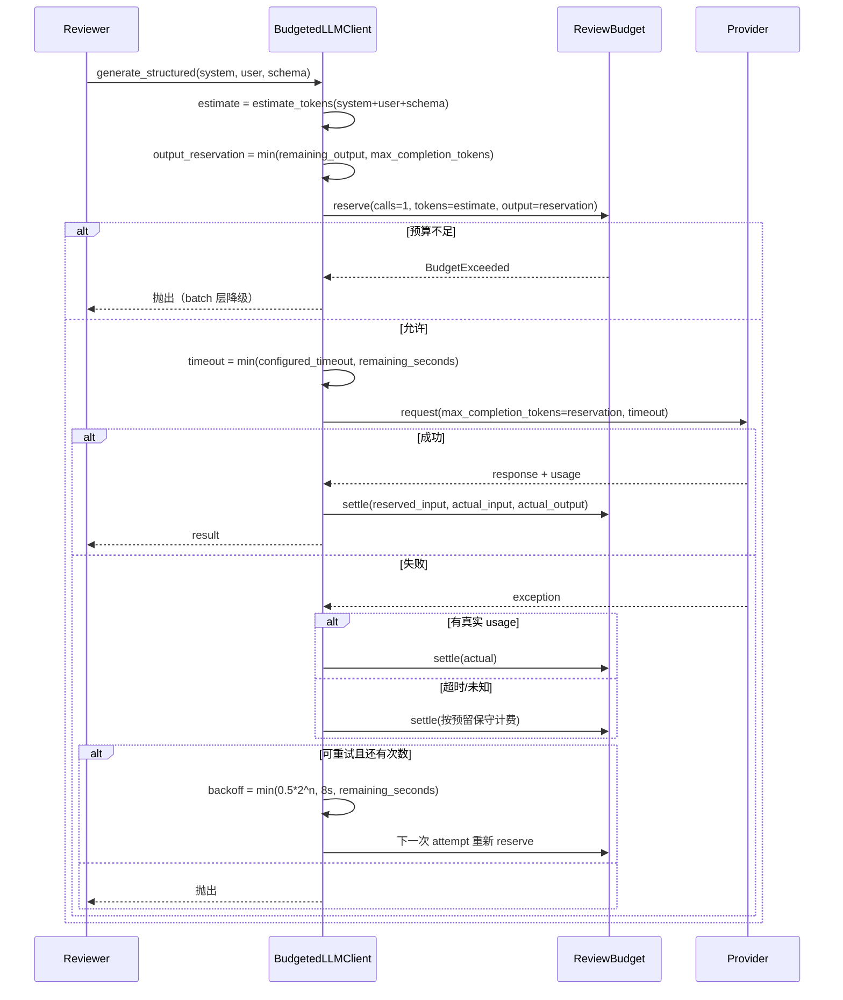

# 05 · 预算与并发

## 1. 四个维度

`ReviewBudget`（`src/openreview/review/workflow.py`）是单次 run 的账本：

| 维度 | 字段 | 默认 | 0 的含义 |
|---|---|---|---|
| LLM 调用数 | `max_llm_calls` | 0 | 不限制 |
| 输入 token | `max_input_tokens` | 0 | 不限制 |
| 输出 token | `max_output_tokens` | 0 | 不限制 |
| 墙钟时间 | `max_seconds` | 0 | 不限制 |

时间预算只约束 LLM 请求，不覆盖仓库准备、索引构建和全部后处理。

## 2. 账本 API

| 方法 | 语义 | 并发安全 |
|---|---|---|
| `allow(...)` | 只检查，不扣减；用于快速预检 | ✅（持锁） |
| `reserve(...)` | 原子检查 + 扣减；不足抛 `BudgetExceeded` | ✅（`RLock`） |
| `try_reserve(...)` | `reserve` 的非异常版本 | ✅ |
| `consume(...)` | 直接扣减；用于绕过客户端的自定义 reviewer 补账 | ✅ |
| `refund(...)` | 退还未实际发出的请求 | ✅ |
| `settle(...)` | 用 provider usage 校正估算输入、结算输出预留 | ✅ |
| `remaining_*()` | 剩余调用/token/输出/时间 | ✅ |

> `allow` + `consume` 不是原子组合。并发路径必须用 `reserve`，否则多个线程可能同时通过检查，把硬预算变成软预算。

## 3. 一次调用的时序

## 4. 关键语义

### 4.1 输出预留

- 预留量 = `min(剩余输出预算, max_completion_tokens)`。
- 预留同时作为请求的 `max_completion_tokens`，防止模型长篇输出把成本打穿。
- 响应后按真实 `completion_tokens` 结算；没有 usage 时按预留保守计费。

### 4.2 输入估算

- `estimate_tokens(system + user + response_schema)`。
- ASCII 按 3 字符/token，CJK 加权 2.2。
- `reserve` 先按估算扣；`settle` 用 provider usage 校正。
- **估算误差可能让当前请求超过输入上限**；该次调用已发生，但后续调用会被拦截，并在 metrics 标记 `input_tokens_over_budget`。

### 4.3 重试计账

- SDK 隐式重试关闭（`OpenAI(max_retries=0)`）。
- `BudgetedLLMClient` 每次 attempt 独立 `reserve`，因此重试也受调用数/时间约束。
- 默认 `llm_max_retries=0`；显式开启后按指数退避，退避时间不超过剩余时间预算。
- 内部抛 `BudgetExceeded` 时 `refund` 本次预留，再向上抛。

### 4.4 并发

- 四个 aspect 若被自定义 reviewer 并发执行，`reserve` 的 `RLock` 保证“检查 + 扣减”是同一临界区。
- 每个 `ReviewSession` 绑定独立 `ReviewBudget`，并发 run 不共享账本。
- metrics 按 `run_id` 汇总调用日志，不对共享累计计数器做前后差分。

## 5. CLI 映射

| CLI | 配置字段 | 说明 |
|---|---|---|
| `--budget-calls` | `budget_calls` | 单 run LLM 调用上限 |
| `--budget-tokens` | `budget_tokens` | 单 run 输入 token 上限（估算） |
| `--budget-output-tokens` | `budget_output_tokens` | 单 run 输出 token 上限 |
| `--budget-seconds` | `budget_seconds` | 单 run LLM 请求时间上限 |
| `--max-completion-tokens` | `max_completion_tokens` | 单次请求输出上限 |

## 6. 预算耗尽时的行为

| 位置 | 行为 |
|---|---|
| `analyze` preflight | 标记 `budget_exhausted`，从当前 batch 起停止 |
| `BudgetedLLMClient` | 抛 `BudgetExceeded`，batch 层捕获并停止 |
| `Verifier` | 剩余 finding 保留原判断，写 note |
| `finalize` | outcome 变为 `partial`，不写 review cache |

## 7. 已知局限

- 不是精确账单：输入 token 为估算，provider 计费口径可能不同。
- 不计算金额：没有单价、缓存折扣、批处理折扣配置。
- 时间预算不覆盖本地检索、仓库准备、报告与评论发布。
- 输出上限依赖 Provider 遵守 `max_completion_tokens` 参数。
